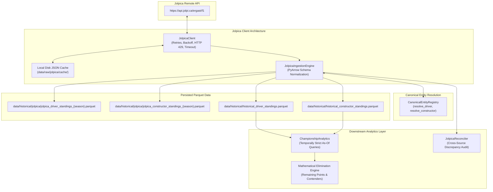

# PACE 1.0 — Jolpica F1 API Integration & Championship Analytics Specification

## 1. Overview & Architectural Role

The Jolpica F1 API (`https://api.jolpi.ca/ergast/f1/`) is the community-developed open-source successor to the legacy Ergast API. In PACE 1.0, Jolpica provides the independent authoritative layer for championship standings, cumulative points progression, event results, and historical as-of standings.

### Source Ownership Boundaries
PACE enforces strict dual-provenance source ownership across all datasets:
- **FastF1:** Primary and authoritative for high-resolution telemetry, speed traps, sector times, and micro-timing (modern era 2023–2026).
- **Kaggle F1 Archive:** Primary offline historical repository for long-term relational datasets (1950–2024).
- **Jolpica F1 API:** Authoritative for official championship standings, cumulative points progression, round-by-round points gaps, and cross-source reconciliation.



---

## 2. Jolpica Client Architecture (`src/data/jolpica_client.py`)

### 2.1 Configurable Base & Resilience
The client is configured via `JolpicaConfig`:
- **Base URL:** `https://api.jolpi.ca/ergast/f1` (Ergast backwards-compatible REST endpoints).
- **User-Agent:** `PACE-F1-Analytics/1.0 (https://github.com/dash-pdf/PACE)`.
- **Timeouts:** 12.0 seconds default.
- **Retry Mechanism:** Exponential backoff with jitter on HTTP 500, 502, 503, 504, ConnectionError, and Timeout up to 4 retries.
- **HTTP 429 Handling:** Respects `Retry-After` header when provided; otherwise applies exponential backoff with jitter.
- **Local Cache:** Raw JSON responses are hashed and cached to `data/raw/jolpica/cache/` to avoid repeated remote calls.

### 2.2 Pagination Engine
Jolpica implements Ergast pagination parameters (`limit` and `offset`), returning total counts in `MRData.total`. The client's `paginate_endpoint` automatically traverses pages in batches of 100 items until `offset + limit >= total`.

### 2.3 Verified Endpoints
| Endpoint Route | Method | Description | PACE Schema Target |
| :--- | :---: | :--- | :--- |
| `/{season}/{round}/driverStandings.json` | GET | Driver standings after specified round | `DRIVER_STANDINGS_SCHEMA` |
| `/{season}/{round}/constructorStandings.json` | GET | Constructor standings after specified round | `CONSTRUCTOR_STANDINGS_SCHEMA` |
| `/{season}/results.json` | GET | Grand Prix race finishing classifications | `RACE_RESULTS_SCHEMA` |
| `/{season}/qualifying.json` | GET | Qualifying session timing results (Q1, Q2, Q3) | `QUALIFYING_RESULTS_SCHEMA` |
| `/{season}/sprint.json` | GET | Sprint race classifications and points | `SPRINT_RESULTS_SCHEMA` |
| `/{season}.json` | GET | Championship calendar and event dates | `EVENTS_SCHEMA` |

---

## 3. Canonical Identity Integration

Raw identifiers from Jolpica/Ergast are resolved into PACE canonical entities using `src/data/canonical_registry.py`:
- **Drivers:** `raw_driver_id` $\to$ `CanonicalDriver.canonical_id`. Drivers with shared surnames (e.g., *Verstappen*, *Schumacher*, *Magnussen*) are resolved with exact full-name matching and unambiguous Ergast identifier lookups.
- **Constructors:** `raw_constructor_id` $\to$ `CanonicalConstructor.canonical_id` (e.g. `red_bull` $\to$ `red_bull`, `sauber` $\to$ `sauber`).
- **Circuits:** `raw_circuit_id` $\to$ `CanonicalCircuit.canonical_id`.
- **Unresolved Tracking:** Unrecognized entities are logged and tracked in `engine.unresolved` for manual inspection rather than silently dropped.

---

## 4. Championship Analytics Foundation (`src/data/championship_analytics.py`)

### 4.1 Temporal As-Of Standings (Zero Future Leakage)
To guarantee statistical validity for model training and simulation, `ChampionshipAnalytics` provides leak-free temporal filtering:
$$\mathcal{S}_{\text{as\_of}}(S, R) = \{ s \in \mathcal{S} \mid s.\text{season} == S \land s.\text{round} == R \}$$
- `before_event=True`: Evaluates standings at round $R - 1$ to supply features strictly prior to race start.
- `before_event=False`: Evaluates standings post-race at round $R$.
- Pre-season queries (Round 1, `before_event=True`) return clean pre-season empty standings without crashing.

### 4.2 Derived Analytics Fields
Every standings query automatically computes:
- `gap_to_leader`: $P_{\text{leader}} - P_i$
- `gap_to_ahead`: $P_{i-1} - P_i$
- `positions_gained_lost`: $\text{Position}_{R-1} - \text{Position}_R$ (+2 indicates gained two positions).

### 4.3 Mathematical Elimination Engine
Calculates maximum available championship points remaining:
$$P_{\text{max\_rem}} = N_{\text{rem}} \times (25 + P_{\text{fl}}) + N_{\text{sprints\_rem}} \times 8$$
*(Fastest lap point $P_{\text{fl}} = 1.0$ for seasons 2019–2024; $0.0$ for 2025–2026 under revised FIA regulations).*

A driver or constructor is mathematically eliminated if:
$$P_{\text{current}} + P_{\text{max\_rem}} < P_{\text{leader}}$$
The engine identifies active contenders, eliminated drivers, and drivers whose mathematical elimination occurred at that exact round.

### 4.4 Title Probability Simulation Contract
Provides a standardized data contract for Phase 4/6 Monte Carlo predictive simulation:
```python
evaluate_championship_outcomes(
    season: int,
    as_of_round: int,
    simulated_remaining_points: Dict[str, List[float]]
) -> Dict[str, float]
```
Combines current standings points with an ensemble of $M$ simulated points across remaining rounds to calculate empirical World Championship title probabilities $\Pr(\text{Title} = d)$.

---

## 5. CLI Usage Examples

```bash
# 1. Test live Jolpica API connectivity and cache directory status
python main.py --jolpica-status

# 2. Ingest 2024 season standings, results, qualifying, sprints, and calendar
python main.py --jolpica-ingest --seasons 2024

# 3. View official championship standings and elimination status as of Round 20
python main.py --jolpica-standings --target-season 2024 --target-round 20

# 4. Run cross-source reconciliation against existing PACE historical datasets
python main.py --jolpica-reconcile --target-season 2024
```

---

## 6. Test Suite & Validation

The integration is verified by 17 unit and integration tests in `tests/test_jolpica_client.py`:
- `test_jolpica_cache_hit_and_miss`: Two-tier caching and zero network calls on cache hit.
- `test_jolpica_http_429_retry_and_backoff`: Rate limit backoff and Retry-After handling.
- `test_jolpica_server_error_exhaustion`: 500 server error retries.
- `test_jolpica_malformed_json_handling`: Malformed JSON exception recovery.
- `test_jolpica_multi_page_pagination`: Limit/offset multi-page traversal.
- `test_ingest_driver_standings_schema_and_canonical_mapping`: PyArrow schema compliance.
- `test_unknown_driver_recorded_for_audit`: Unresolved entity audit tracking.
- `test_championship_analytics_as_of_temporal_isolation`: Zero temporal leakage validation.
- `test_mathematical_elimination_calculation`: Contender vs. elimination logic.
- `test_scoring_rules_variations`: 2024 vs 2026 scoring rules.
- `test_evaluate_championship_outcomes_simulation_contract`: Simulation title probabilities.
- `test_jolpica_reconciliation_conflict_detection`: Discrepancy detection and reporting.
- `test_ingest_constructor_standings_schema`: Constructor schema validation.
- `test_ingest_race_results_schema`: Race classification and timing schema validation.
- `test_points_progression_trajectory`: Delta points scored per round calculation.
- `test_championship_as_of_round_1_preseason`: Pre-season round 1 edge cases.
- `test_idempotent_multi_season_ingestion`: Deduplication and idempotent persistence.
