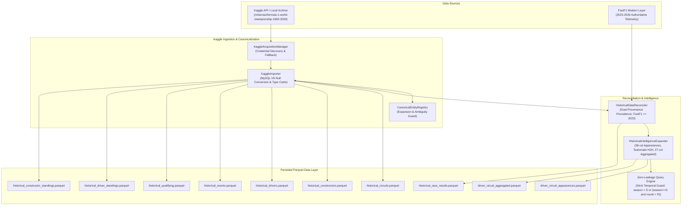

# PACE 1.0 — Kaggle Historical Dataset Integration Specification

## 1. Dataset Origin & Architectural Scope

The Formula 1 World Championship historical dataset curated by Rohan Rao spans the complete official history of modern Formula 1 from the inaugural 1950 British Grand Prix at Silverstone through the 2024 championship season. In PACE 1.0, this dataset serves as the foundational multi-decade historical intelligence layer, supplementing the high-precision FastF1 telemetry and timing infrastructure (primary for modern seasons 2023–2026).



---

## 2. Ingestion Mechanics & Data Cleansing

### 2.1 MySQL `\N` Null Conversion
Kaggle exports relational tables directly from a MySQL database dump, representing null values using raw `\N` strings. The PACE importer reads all CSV files with `na_values=["\\N", r"\N", ""]` and `keep_default_na=True`, ensuring all numeric, string, and timestamp fields convert cleanly to native Python `None` and IEEE 754 floating-point `NaN`.

### 2.2 Quarantine for Broken Referential Integrity
Every race result and qualifying session is verified against foreign keys:
- `raceId` must exist in `races.csv` / `events.parquet`.
- `driverId` must resolve in `drivers.csv` / `drivers.parquet`.
- `constructorId` must resolve in `constructors.csv` / `constructors.parquet`.

Orphaned records are quarantined in `importer.quarantined_records` with detailed contextual logging and are excluded from master historical tables.

---

## 3. Canonical Registry Expansion & Ambiguity Guards

PACE enforces immutable canonical identifiers across all data sources. Historical entities are registered without corrupting active 2026 driver/team identities:

1. **Historical Drivers:**
   - Pre-2000 legends (e.g., `fangio`, `farina`, `ascari`, `stewart`, `clark`, `hunt`, `lauda`, `senna`, `prost`, `graham_hill`, `damon_hill`, `ralf_schumacher`) are registered with `active_2026=False`.
2. **Historical Constructors:**
   - Defunct teams (e.g., `alfa`, `maserati`, `brm`, `team_lotus`, `jordan`, `tyrrell`, `brabham`, `benetton`) are registered with `active_2026=False`.
3. **Historical Circuits:**
   - Heritage and deprecated Grand Prix venues (e.g., `fuji`, `nurburgring`, `watkins_glen`, `caesars_palace`) are registered with calibrated circuit characteristics.
4. **Collision & Ambiguity Guards:**
   - Surnames shared across multiple drivers (e.g., *Hill*: Graham vs Damon vs Phil; *Schumacher*: Michael vs Ralf vs Mick; *Fittipaldi*: Emerson vs Christian vs Pietro) are tracked in `_driver_ambiguous_aliases`.
   - Strict resolution raises `AmbiguousEntityError`. Non-strict resolution returns `is_resolved=False` with candidate identities rather than silently misassigning careers.

---

## 4. Source Precedence & Dual-Provenance Reconciliation

PACE implements an explicit dual-provenance reconciliation protocol:

| Era | Target Seasons | Authoritative Source | Secondary Source | Reconciliation Rule |
| :--- | :--- | :--- | :--- | :--- |
| **Historical Era** | $1950 \le \text{season} \le 2022$ | **Kaggle F1 Archive** | Ergast / Jolpica | Kaggle provides broad multi-decade career coverage. Merged with existing pre-2023 telemetry where available without overwriting. |
| **Modern Era** | $2023 \le \text{season} \le 2026$ | **FastF1 Telemetry** | Kaggle F1 Archive | FastF1 is primary and authoritative for timing, lap telemetry, and sector analysis. Kaggle overlaps are audited; discrepancies log conflicts and defer to FastF1. |

### Reconciliation Conflict Resolution
During modern-era reconciliation, overlapping records are evaluated across:
- `finish_position`
- `grid_position`
- `points`
- `is_classified`
- `is_dnf`

In identical matches, `report.identical_count` increments. Where discrepancies occur, FastF1 takes precedence, and the conflict details are recorded in `ReconciliationConflict`.

---

## 5. Multi-Era Driver-Circuit Intelligence

### 5.1 38-Column Appearances Schema (`DRIVER_CIRCUIT_APPEARANCES_SCHEMA`)
Granular event appearances are compiled across the full history of the sport:

```text
driver_id, circuit_id, season, round, event_name, event_date,
regulation_era, constructor_id, constructor_name, grid_position,
finish_position, position_text, positions_gained_lost, points,
laps_completed, status, is_classified, is_dnf, is_dns, is_dsq,
qualifying_position, q1_time_str, q1_time_ms, q2_time_str, q2_time_ms,
q3_time_str, q3_time_ms, fastest_lap_rank, fastest_lap_time,
fastest_lap_speed, total_race_time_ms, teammate_driver_id,
teammate_grid_position, teammate_finish_position, beat_teammate_race,
beat_teammate_qualy, source_api, retrieved_at
```

### 5.2 Teammate Head-to-Head Matching
Within each `(season, round, constructor_id)` team grouping:
- Teammate identity is isolated (`teammate_driver_id`).
- Qualifying head-to-head (`beat_teammate_qualy`) compares official qualifying times / positions.
- Race head-to-head (`beat_teammate_race`) accounts for classification status:
  - Both classified: lower finish position wins.
  - One classified, one DNF: classified driver wins.
  - Both DNF: recorded as `None` (unresolved).

### 5.3 27-Column Aggregated Performance Profiles (`DRIVER_CIRCUIT_AGGREGATED_SCHEMA`)
Profiles aggregate historical performance per `(driver_id, circuit_id)`:
- `total_starts`, `first_season`, `latest_season`
- `wins`, `podiums`, `poles`, `top_5_finishes`, `top_10_finishes`
- `dnf_count`, `dnf_rate`
- `total_points`, `avg_points_per_start`
- `avg_grid_position`, `avg_finish_position`, `avg_positions_gained`
- `best_finish_position`, `best_grid_position`
- `teammate_race_h2h_wins`, `teammate_qualy_h2h_wins`, `teammate_race_h2h_rate`, `teammate_qualy_h2h_rate`
- `ground_effect_starts`, `ground_effect_avg_finish`

### 5.4 Provable Zero-Leakage Guarantee
To guarantee statistical validity and prevent target leakage in Phase 3 and Phase 4/6 model features, PACE provides `HistoricalIntelligenceExpander.query_historical_profile`:
$$\mathcal{E}_{\text{valid}} = \{ e \in \mathcal{E} \mid e.\text{season} < S \lor (e.\text{season} == S \land e.\text{round} < R) \}$$
All career starts, win counts, teammate metrics, and track affinities for target event $(S, R)$ strictly observe only $\mathcal{E}_{\text{valid}}$.

---

## 6. Persisted Parquet Data Layer

All 12 historical tables and derived intelligence datasets are persisted to `data/historical/`:

| Dataset Path | Schema | Records | Coverage | Columns |
| :--- | :--- | :---: | :---: | :---: |
| `data/historical/historical_race_results.parquet` | `RACE_RESULTS_SCHEMA` | 27,587 | 1950–2026 | 23 |
| `data/historical/historical_circuits.parquet` | `CIRCUITS_SCHEMA` | 77 | 1950–2026 | 9 |
| `data/historical/historical_constructors.parquet` | `CONSTRUCTORS_SCHEMA` | 204 | 1950–2026 | 6 |
| `data/historical/historical_drivers.parquet` | `DRIVERS_SCHEMA` | 882 | 1950–2026 | 11 |
| `data/historical/historical_events.parquet` | `EVENTS_SCHEMA` | 1,172 | 1950–2026 | 9 |
| `data/historical/historical_qualifying.parquet` | `QUALIFYING_RESULTS_SCHEMA` | 11,408 | 1994–2026 | 15 |
| `data/historical/historical_driver_standings.parquet` | `DRIVER_STANDINGS_SCHEMA` | 35,813 | 1950–2026 | 9 |
| `data/historical/historical_constructor_standings.parquet` | `CONSTRUCTOR_STANDINGS_SCHEMA` | 13,851 | 1958–2026 | 9 |
| `data/historical/historical_pit_stops.parquet` | `PIT_STOPS_SCHEMA` | 22,950 | 1994–2026 | 10 |
| `data/historical/historical_sprints.parquet` | `SPRINT_RESULTS_SCHEMA` | 612 | 2021–2026 | 22 |
| `data/historical/driver_circuit/driver_circuit_appearances.parquet` | `DRIVER_CIRCUIT_APPEARANCES_SCHEMA` | 27,587 | 1950–2026 | 38 |
| `data/historical/driver_circuit/driver_circuit_aggregated.parquet` | `DRIVER_CIRCUIT_AGGREGATED_SCHEMA` | 8,356 | 1950–2026 | 27 |

---

## 7. Reproduction & Execution Instructions

### 7.1 Running with Kaggle API Credentials
1. Place `kaggle.json` in `~/.kaggle/kaggle.json` or export:
   ```bash
   export KAGGLE_USERNAME="your_username"
   export KAGGLE_KEY="your_api_key"
   ```
2. Execute the integration pipeline:
   ```bash
   ./venv/bin/python -c "from src.data.kaggle_importer import run_kaggle_historical_integration; res = run_kaggle_historical_integration(); print(res.summary_message)"
   ```

### 7.2 Running with Local Reference Archive (Air-Gapped / Offline)
1. Place CSV files (`races.csv`, `drivers.csv`, `constructors.csv`, `circuits.csv`, `results.csv`, `status.csv`, `qualifying.csv`, `driver_standings.csv`, `constructor_standings.csv`) in `data/raw/kaggle/`.
2. The acquisition manager automatically detects the local archive and proceeds without network requests.

### 7.3 Automated Test Suite Execution
```bash
./venv/bin/pytest tests/test_kaggle_importer.py -v
```
All 9 dedicated unit and integration tests validate null parsing, schema conformance, precedence rules, teammate matching, zero-leakage isolation, and referential integrity.
