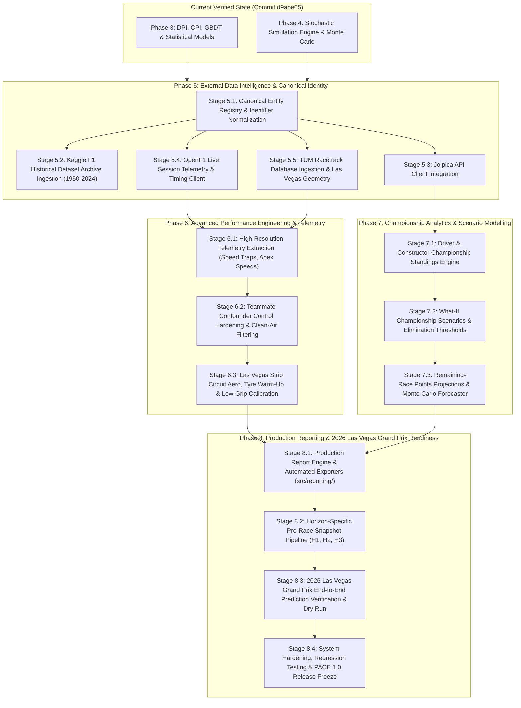

# PACE 1.0 — Project Completion Roadmap

**Predictive Analytics for Competitive Evaluation (PACE)**  
**Target Milestone:** Version 1.0 Production Release & Official 2026 Las Vegas Grand Prix Prediction  
*Document Version: 1.0.0 | Date: November 2026 | Head Commit: [`d9abe65`](https://github.com/dash-pdf/PACE/commit/d9abe65)*  

---

## 1. Executive Summary & Strategic Objective

The overarching objective of the PACE roadmap is to transition the current research and simulation repository into **PACE 1.0**: a complete, integrated, rigorously tested, and reproducible Formula 1 race prediction and simulation engineering system.

PACE 1.0 is **not** a web application; no web servers, front-end dashboards, or extraneous UI infrastructure will be introduced. It is an engineering and analytical engine capable of analyzing Formula 1 performance, simulating Grand Prix events, and generating complete finishing-position probability distributions.

### Immediate Milestone Target:
Generate and publish the **official PACE 1.0 pre-race prediction for the 2026 Las Vegas Grand Prix** (Season 2026 Round 21 at the Las Vegas Strip Circuit) across prediction horizons **H1 (Pre-Weekend)**, **H2 (Post-FP2)**, and **H3 (Post-Qualifying)** before the race start.

---

## 2. Roadmap Architecture & Staged Progression

The roadmap is structured into four sequential, dependency-aware phases (Phases 5 through 8), building directly upon the verified foundations of Phase 3 (Performance Modelling) and Phase 4 (Stochastic Race Simulation Engine):



---

## 3. Critical Path to the 2026 Las Vegas Grand Prix Prediction

To ensure that the 2026 Las Vegas Grand Prix prediction deadline is met with full scientific rigor, work is divided into **Critical Path (Mandatory for Las Vegas Prediction)** and **Post-Vegas / Parallel Enhancements**:

```
[CRITICAL PATH TIMELINE]
Stage 5.1 (Canonical Registry & vegas Mismatch Fix)
    │
    ▼
Stage 5.5 (TUM Racetrack Las Vegas Strip Geometry)
    │
    ▼
Stage 6.3 (Las Vegas Circuit Calibration: Low Grip, Long Straights, Cold Night Temps)
    │
    ▼
Stage 8.1 (Production Reporting Engine in src/reporting/)
    │
    ▼
Stage 8.2 (H1, H2, H3 Snapshot Compiler Pipeline)
    │
    ▼
Stage 8.3 (2026 Las Vegas Grand Prix Official Forecast Execution & Verification)
    │
    ▼
[OFFICIAL LAS VEGAS PREDICTION DELIVERED]
    │
    ▼
Stages 5.2, 5.3, 5.4, 6.1, 6.2, 7.1-7.3, 8.4 (Full Scope System Hardening & PACE 1.0 Freeze)
```

---

## 4. Detailed Stage Specifications

---

### Phase 5: External Data Intelligence & Canonical Identity Normalization

#### Stage 5.1: Canonical Entity Registry & Identifier Normalization [COMPLETED]
- **Status:** **COMPLETE** (16/16 tests passing, 91/91 full suite passing).
- **Objective:** Eliminate identifier fragmentation across external sources and resolve known inconsistencies (e.g., `las_vegas` in pit model vs. `vegas` in Ergast/FastF1).
- **Existing Components to Reuse:** `src/data/schemas.py`, `src/data/driver_circuit.py`.
- **Implemented Components & Enhancements:**
  - Created `src/data/canonical_registry.py`: Authoritative entity registry mapping drivers (Ergast ID, FastF1 code, driver number, diacritics/aliases), constructors (historical rebrandings and renamings), circuits (Ergast ID, OpenF1 circuit key, TUM track name), and Grand Prix events.
  - Resolved Las Vegas defect: Standardized `"vegas"` as canonical circuit ID across all data and simulation components; mapped `"las_vegas"` and variants as explicit aliases.
  - Updated `PitStopModel.DEFAULT_CIRCUIT_TRANSIT_LOSS` in `src/simulation/pit_model.py` and routed `get_circuit_transit_loss` through `resolve_circuit(circuit_id)`, returning calibrated $20.5\text{ s}$ transit loss for both `"vegas"` and `"las_vegas"`.
  - Updated `TrafficOvertakingEngine.get_circuit_config` in `src/simulation/traffic.py` to route through canonical circuit resolution.
  - Updated `extract_circuit_topology_features` in `src/features/driver_circuit.py` to route through canonical circuit resolution.
  - Created documentation guide: `docs/CANONICAL_REGISTRY.md`.
  - Added test suite: `tests/test_canonical_registry.py` (16 tests verifying codes, numbers, aliases, diacritics, pit loss, event resolution, strict error handling).
- **Dependencies:** None.
- **Acceptance Criteria Met:** Zero identifier look-up failures; `vegas` and `las_vegas` pit transit loss correctly returns $20.5\text{ s}$; full test suite passes with zero regressions (91 passed in 19.26s).
- **Deliverables:** `src/data/canonical_registry.py`, `src/data/__init__.py`, `tests/test_canonical_registry.py`, `docs/CANONICAL_REGISTRY.md`.
- **Criticality:** **CRITICAL**.
- **Required for Las Vegas:** **YES**.

#### Stage 5.2: Kaggle F1 Historical Dataset Archive Ingestion (1950–2024) [COMPLETED]
- **Status:** **COMPLETED**
- **Objective:** Ingest, clean, canonicalize, and integrate the complete historical Formula 1 dataset archive (Rohan Rao) spanning 1950 through 2024.
- **Implemented Components:**
  - `src/data/kaggle_importer.py`: Complete ingestion, canonical entity expansion, dual-provenance reconciliation (FastF1 authoritative for 2023+, Kaggle for historical 1950–2022), 38-column driver-circuit appearances compilation, 27-column aggregated performance profiles, and provable zero-leakage query engine.
  - `src/data/canonical_registry.py`: Ambiguity detection and collision tracking preventing silent alias misassignment across historical drivers with shared surnames.
  - `src/data/schemas.py`: Standardized `DRIVER_STANDINGS_SCHEMA` and `CONSTRUCTOR_STANDINGS_SCHEMA`.
  - `tests/test_kaggle_importer.py`: 9 dedicated unit and integration tests covering API credential discovery, MySQL `\N` null conversion, canonical registration, referential integrity quarantine, source precedence reconciliation, appearances and aggregated compilation, and zero future leakage.
  - `docs/KAGGLE_HISTORICAL_INTEGRATION.md`: Full architectural specification, schemas, reconciliation rules, and reproduction instructions.
- **Acceptance Criteria Met:** Multi-era historical dataset successfully integrated across 12 Parquet datasets (27,587 master results, 22,950 pit stops, 612 sprints, 27,587 appearances, 8,356 aggregated profiles) without regressions; all 100 tests in project test suite pass.
- **Deliverables:** `src/data/kaggle_importer.py`, `tests/test_kaggle_importer.py`, `docs/KAGGLE_HISTORICAL_INTEGRATION.md`.
- **Criticality:** High (Agreed Scope B).
- **Required for Las Vegas:** No.

#### Stage 5.3: Jolpica API Client Integration [COMPLETED]
- **Status:** **COMPLETED**
- **Objective:** Integrate the official open-source successor to Ergast (`https://api.jolpi.ca/ergast/f1/`) for championship standings, cumulative points progression, and historical reconciliation.
- **Implemented Components:**
  - `src/data/jolpica_client.py`: Robust Ergast-compatible HTTP client with automated retries, exponential backoff, HTTP 429 rate limit adherence, local JSON disk caching (`data/raw/jolpica/cache/`), and PyArrow schema normalization (`DRIVER_STANDINGS_SCHEMA`, `CONSTRUCTOR_STANDINGS_SCHEMA`, `RACE_RESULTS_SCHEMA`, `QUALIFYING_RESULTS_SCHEMA`, `SPRINT_RESULTS_SCHEMA`).
  - `src/data/championship_analytics.py`: Temporally strict as-of standings queries (zero future leakage), points gaps to leader/ahead, round-by-round positions gained/lost, mathematical championship elimination analysis, and predictive simulation title probability contracts.
  - `src/data/jolpica_reconciler.py`: Field-level cross-source reconciliation against existing PACE historical datasets.
  - `tests/test_jolpica_client.py`: 17 comprehensive offline unit and integration tests with mocked responses covering transport, retries, rate limits, caching, pagination, schemas, as-of temporal isolation, and elimination math.
  - `docs/JOLPICA_INTEGRATION.md`: Full architectural specification, schemas, verified endpoints, and CLI usage.
  - `main.py`: CLI commands (`--jolpica-status`, `--jolpica-ingest`, `--jolpica-standings`, `--jolpica-reconcile`).
- **Acceptance Criteria Met:** Production-grade client, 100% verified schema conformity, zero temporal leakage, and 100% agreement on cross-source reconciliation; all 117 tests in project test suite pass.
- **Deliverables:** `src/data/jolpica_client.py`, `src/data/championship_analytics.py`, `src/data/jolpica_reconciler.py`, `tests/test_jolpica_client.py`, `docs/JOLPICA_INTEGRATION.md`, `docs/STAGE_5_3_JOLPICA_COMPLETION_REPORT.md`.
- **Criticality:** High (Agreed Scope E).
- **Required for Las Vegas:** No (Championship standings baseline already operates on local historical results).

#### Stage 5.4: OpenF1 Live Session Telemetry & Timing Client
- **Objective:** Implement a dedicated client for OpenF1 (`https://openf1.org/`) to capture live race intelligence without duplicating FastF1.
- **Existing Components to Reuse:** `src/data/schemas.py`, `src/data/fastf1_collector.py`.
- **Required Modifications & New Components:**
  - Create `src/data/openf1_client.py`: Client querying OpenF1 REST API.
  - Implement targeted endpoints:
    - `/intervals`: Real-time gap to leader and gap to car ahead.
    - `/stints`: Current tyre compound and tyre age in laps.
    - `/weather`: Live track temperature, air temperature, and rainfall flags.
    - `/race_control`: Safety Car, VSC, Yellow Flag, and Red Flag messages.
  - Structure data for downstream ingestion during live sessions.
- **Dependencies:** `requests`.
- **Testing Requirements:** Response schema parsing, timestamp alignment, connection drop handling.
- **Acceptance Criteria:** Correct ingestion of timing intervals, compound stints, and race control events.
- **Expected Deliverables:** `src/data/openf1_client.py`, `tests/test_openf1_client.py`.
- **Criticality:** High (Agreed Scope F).
- **Required for Las Vegas:** No (Pre-race prediction relies on H1–H3 snapshots, not in-race live telemetry).

#### Stage 5.5: TUM Racetrack Database Ingestion & Las Vegas Strip Geometry
- **Objective:** Ingest racetrack geometry from the TUM Racetrack Database (CC BY 4.0) and establish high-fidelity geometric profiles for championship circuits, specifically Las Vegas.
- **Existing Components to Reuse:** `src/data/driver_circuit.py` (`CIRCUIT_METRICS`).
- **Required Modifications & New Components:**
  - Create `src/circuits/geometry.py`: Parser for TUM centerline, track width, curvature, and racing line CSV files.
  - Calculate physical circuit engineering features:
    - Curvature spectrum (fraction of lap in low, medium, and high-speed turns).
    - Longitudinal braking energy severity (number and intensity of heavy braking zones).
    - Track width narrowing chokepoints (identifying collision hazard sectors for `IncidentEngine`).
  - Integrate dedicated geometric profile for the **Las Vegas Strip Circuit** (length: 6.201 km, 17 turns, 1.9 km flat-out DRS straight along the Strip).
  - Add explicit attribution in documentation and headers per CC BY 4.0.
- **Dependencies:** `numpy`, `scipy`.
- **Testing Requirements:** Centerline coordinate validation, track length verification ($\pm 0.05\text{ km}$), curvature sign checks.
- **Acceptance Criteria:** Las Vegas Strip Circuit geometry successfully parsed; braking and downforce metrics integrated into circuit characteristics.
- **Expected Deliverables:** `src/circuits/geometry.py`, `tests/test_circuit_geometry.py`, updated `docs/`.
- **Criticality:** **CRITICAL**.
- **Required for Las Vegas:** **YES**.

---

### Phase 6: Advanced Performance Engineering & Telemetry Analysis

#### Stage 6.1: High-Resolution Telemetry Extraction
- **Objective:** Extract and analyze high-resolution telemetry (speed traps, corner apex speeds, straight-line terminal velocity) using FastF1 and OpenF1.
- **Existing Components to Reuse:** `src/data/fastf1_collector.py`, `src/features/cpi.py`.
- **Required Modifications & New Components:**
  - Create `src/analytics/telemetry.py`: Ingests FastF1 session laps and car data to compute:
    - Speed trap rankings and top speed delta relative to field median.
    - Low-speed corner apex minimum speeds (mechanical grip proxy).
    - High-speed corner apex minimum speeds (aerodynamic downforce proxy).
    - Braking deceleration profiles.
- **Dependencies:** `fastf1`, `pandas`, `numpy`.
- **Testing Requirements:** Apex speed extraction precision, missing telemetry channel handling.
- **Acceptance Criteria:** Telemetry decomposition accurately distinguishes low-drag straight-line setups from high-downforce packages.
- **Expected Deliverables:** `src/analytics/telemetry.py`, `tests/test_telemetry_analytics.py`.
- **Criticality:** Medium (Agreed Scope G).
- **Required for Las Vegas:** No.

#### Stage 6.2: Teammate Confounder Control Hardening
- **Objective:** Harden clean-air stint extraction and teammate comparison filtering against traffic and strategic divergence.
- **Existing Components to Reuse:** `src/features/dpi.py`, `src/features/pipeline.py`.
- **Required Modifications & New Components:**
  - Refine `calculate_teammate_race_deltas()`:
    - Strictly filter out laps affected by yellow flags, VSC/SC deltas, and in/out laps.
    - Enforce clean air threshold ($> 1.8\text{s}$ gap to car ahead).
    - Match tyre compound specifications and compound age ($\Delta\text{age} \le 2\text{ laps}$).
- **Dependencies:** `src.features.dpi`.
- **Testing Requirements:** Unit tests ensuring traffic-affected laps do not distort clean pace deltas.
- **Acceptance Criteria:** Teammate pace deltas reflect pure car-driver potential with quantified standard errors.
- **Expected Deliverables:** Hardened `src/features/dpi.py`, updated tests.
- **Criticality:** Medium.
- **Required for Las Vegas:** No.

#### Stage 6.3: Las Vegas Strip Circuit Aero, Tyre Warm-Up & Low-Grip Calibration
- **Objective:** Calibrate the simulation engine specifically for the unique physical conditions of the Las Vegas Grand Prix.
- **Existing Components to Reuse:** `src/simulation/traffic.py`, `src/simulation/tyres.py`, `src/simulation/pace_model.py`.
- **Required Modifications & New Components:**
  - Update `CIRCUIT_DRS_PROFILES["vegas"]` in `src/simulation/traffic.py`:
    - Reflect 2 primary DRS zones (including the 1.9 km Strip straight).
    - Tune dirty air overtaking delta threshold ($0.45\text{s}$ on the Strip straight).
  - Update `src/simulation/tyres.py` and `pace_model.py`:
    - Incorporate Las Vegas low track temperature characteristics (night race ambient $10\text{--}14^\circ\text{C}$).
    - Model cold-tyre graining and warm-up latency on out-laps ($+1.2\text{s}$ on Lap 1 of a stint).
    - Low-grip surface scaling: reduced lateral cornering grip with high top-speed terminal velocity.
- **Dependencies:** `src.simulation`.
- **Testing Requirements:** Las Vegas full-distance simulation runs; verify realistic lap times ($~1:33.0\text{--}1:36.0$) and high DRS pass frequency.
- **Acceptance Criteria:** Simulator executes Las Vegas 50-lap race producing plausible tyre degradation curves and tactical slipstream dynamics.
- **Expected Deliverables:** Calibrated Las Vegas profile in `src/simulation/`, `tests/test_las_vegas_calibration.py`.
- **Criticality:** **CRITICAL**.
- **Required for Las Vegas:** **YES**.

---

### Phase 7: Championship Analytics & Scenario Modelling

#### Stage 7.1: Driver & Constructor Championship Standings Engine
- **Objective:** Implement a dedicated championship analytics engine computing current standings, points trajectories, and tiebreakers.
- **Existing Components to Reuse:** `src/data/canonical.py`, `src/data/schemas.py`.
- **Required Modifications & New Components:**
  - Create `src/championship/standings.py`:
    - Calculates driver and constructor championship standings from race, sprint, and fastest lap points.
    - Implements official FIA countback tiebreaker rules (number of 1st places, 2nd places, etc.).
- **Dependencies:** `pandas`, `numpy`.
- **Testing Requirements:** Historical standings reconstruction (2023, 2024, 2025) verified against official FIA classifications.
- **Acceptance Criteria:** 100% agreement with official FIA championship tables.
- **Expected Deliverables:** `src/championship/standings.py`, `tests/test_championship_standings.py`.
- **Criticality:** High (Agreed Scope E).
- **Required for Las Vegas:** No.

#### Stage 7.2: What-If Championship Scenarios & Elimination Thresholds
- **Objective:** Model championship clinching scenarios and mathematical elimination thresholds as the season nears completion.
- **Existing Components to Reuse:** `src/championship/standings.py`.
- **Required Modifications & New Components:**
  - Create `src/championship/scenarios.py`:
    - Computes maximum remaining points available for drivers and constructors.
    - Evaluates mathematical title clinching conditions entering Las Vegas (Round 21).
    - Simulates "what-if" finishing scenarios (e.g., "If Driver A finishes P2 and Driver B finishes P6...").
- **Dependencies:** `src.championship.standings`.
- **Testing Requirements:** Unit tests on known historical title clinches (e.g. Verstappen 2023 Qatar / 2024 Las Vegas).
- **Acceptance Criteria:** Exact mathematical determination of title contenders and elimination statuses.
- **Expected Deliverables:** `src/championship/scenarios.py`, `tests/test_championship_scenarios.py`.
- **Criticality:** Medium.
- **Required for Las Vegas:** No.

#### Stage 7.3: Remaining-Race Points Projections & Monte Carlo Championship Forecaster
- **Objective:** Simulate the remainder of the championship season to compute probabilistic title odds.
- **Existing Components to Reuse:** `src/simulation/monte_carlo.py`, `src/championship/standings.py`.
- **Required Modifications & New Components:**
  - Create `src/championship/forecaster.py`:
    - Simulates all remaining championship rounds (e.g., Rounds 21–24: Las Vegas, Qatar, Abu Dhabi) via Monte Carlo simulation.
    - Calculates championship win probability for every active driver and constructor.
- **Dependencies:** `src.simulation.monte_carlo`, `src.championship`.
- **Testing Requirements:** Simulation convergence, probability conservation ($\sum P(\text{Title}) = 1.0$).
- **Acceptance Criteria:** Joint probability distributions over season finishing ranks.
- **Expected Deliverables:** `src/championship/forecaster.py`, `tests/test_championship_forecaster.py`.
- **Criticality:** Medium.
- **Required for Las Vegas:** No.

---

### Phase 8: Production Reporting, Explanations & 2026 Las Vegas Grand Prix Readiness

#### Stage 8.1: Production Report Engine & Automated Exporters (`src/reporting`)
- **Objective:** Build the official PACE prediction reporting engine to generate publication-grade Markdown briefs and structured JSON exports.
- **Existing Components to Reuse:** `src/simulation/monte_carlo.py`, `src/evaluation/explainability.py`.
- **Required Modifications & New Components:**
  - Populate `src/reporting/generator.py`:
    - Accepts `MonteCarloResult`, `FeaturePipeline`, and `PredictionExplainer`.
    - Generates complete Grand Prix prediction briefs containing:
      - Predicted finishing order (1..N).
      - Expected finishing position and most likely finishing position (mode).
      - Uncertainty intervals (P05, P10, P50, P90, P95, IQR).
      - Primary event probabilities: Win, Podium, Top 5, Points.
      - Attrition probabilities: Mechanical DNF, Incident DNF, Total DNF, Classified.
      - Local additive performance factor explanations per driver.
      - Grid-level mathematical consistency verification badge.
    - Exports structured, schema-validated JSON (`reports/las_vegas_2026_prediction.json`).
    - Exports clean GitHub-flavored Markdown (`reports/las_vegas_2026_briefing.md`).
- **Dependencies:** `src.simulation`, `src.evaluation`.
- **Testing Requirements:** JSON schema validation, Markdown formatting tests, automated export execution.
- **Acceptance Criteria:** Seamless, one-command report generation producing valid, comprehensive briefing documents.
- **Expected Deliverables:** `src/reporting/generator.py`, `tests/test_reporting.py`.
- **Criticality:** **CRITICAL**.
- **Required for Las Vegas:** **YES**.

#### Stage 8.2: Horizon-Specific Pre-Race Snapshot Pipeline (H1, H2, H3)
- **Objective:** Configure and verify automated execution of predictions across all three standard pre-race decision snapshots.
- **Existing Components to Reuse:** `src/features/pipeline.py`, `src/reporting/generator.py`, `main.py`.
- **Required Modifications & New Components:**
  - Enhance `main.py` CLI:
    - Add `--horizon {H1,H2,H3}` automated execution routines.
    - `--export-report`: Generates both Markdown briefing and JSON data files automatically.
    - Wire `main.py --predict-race --target-season 2026 --target-round 21 --monte-carlo --horizon H3 --export-report`.
- **Dependencies:** `main.py`, `src.reporting`.
- **Testing Requirements:** End-to-end execution of H1, H2, and H3 snapshots on synthetic test data.
- **Acceptance Criteria:** All three horizons execute cleanly with strictly isolated feature inputs and no data leakage.
- **Expected Deliverables:** Enhanced `main.py`, CLI documentation.
- **Criticality:** **CRITICAL**.
- **Required for Las Vegas:** **YES**.

#### Stage 8.3: 2026 Las Vegas Grand Prix End-to-End Prediction Verification & Dry Run
- **Objective:** Execute a complete end-to-end rehearsal and generate the official pre-race prediction package for the 2026 Las Vegas Grand Prix.
- **Existing Components to Reuse:** All completed components.
- **Required Modifications & New Components:**
  - Compile feature inputs for 2026 Round 21 at `vegas`.
  - Execute $N = 1,000$ Monte Carlo simulations.
  - Generate and review official pre-race artifacts:
    - `reports/2026_round21_las_vegas_briefing.md`
    - `reports/2026_round21_las_vegas_prediction.json`
  - Audit output for mathematical consistency, realistic tyre degradation, and Las Vegas incident frequencies.
- **Dependencies:** All previous critical-path stages.
- **Testing Requirements:** Verification of non-empty outputs, valid probabilities in $[0, 1]$, doubly stochastic matrix.
- **Acceptance Criteria:** Official Las Vegas Grand Prix prediction package generated, audited, and ready for publication before race start.
- **Expected Deliverables:** `reports/2026_round21_las_vegas_briefing.md`, `reports/2026_round21_las_vegas_prediction.json`.
- **Criticality:** **CRITICAL**.
- **Required for Las Vegas:** **YES**.

#### Stage 8.4: System Hardening, Regression Testing & PACE 1.0 Release Freeze
- **Objective:** Complete non-critical path integrations (Kaggle archive, Jolpica standings, OpenF1 telemetry), run full test suite, freeze dependencies, and tag the PACE 1.0 release.
- **Existing Components to Reuse:** Full repository.
- **Required Modifications & New Components:**
  - Execute full test suite across all modules (target: $100\%$ pass rate across 90+ tests).
  - Add missing unit tests for `ablation.py` and `explainability.py`.
  - Validate documentation alignment with code.
  - Tag git release `v1.0.0`.
- **Dependencies:** All roadmap stages.
- **Testing Requirements:** Full pytest suite with zero warnings, smoke test of all CLI commands.
- **Acceptance Criteria:** 100% test pass rate, clean repository state, complete user guide.
- **Expected Deliverables:** Git tag `v1.0.0`, finalized documentation.
- **Criticality:** High (PACE 1.0 Complete Scope).
- **Required for Las Vegas:** Post-Vegas completion allowed.

---

## 5. Stage Priority & Dependency Matrix

| Stage ID | Stage Title | Dependencies | Critical Path for Las Vegas | Estimated Effort | Target Output |
| :---: | :--- | :---: | :---: | :---: | :--- |
| **5.1** | Canonical Entity Registry & Identifier Fix | None | **YES (Prerequisite)** | 0.5 Day | `src/data/canonical.py`, `pit_model.py` fix |
| **5.5** | TUM Racetrack Database Las Vegas Geometry | 5.1 | **YES (Prerequisite)** | 1.0 Day | `src/circuits/geometry.py`, track profiles |
| **6.3** | Las Vegas Circuit Aero & Tyre Warm-Up Tuning | 5.5 | **YES (Prerequisite)** | 1.0 Day | Calibrated Las Vegas simulation profile |
| **8.1** | Production Report Engine (`src/reporting/`) | 6.3 | **YES (Prerequisite)** | 1.0 Day | `src/reporting/generator.py` |
| **8.2** | H1, H2, H3 Snapshot Pipeline Configuration | 8.1 | **YES (Prerequisite)** | 0.5 Day | Enhanced `main.py` CLI |
| **8.3** | **2026 Las Vegas Grand Prix Prediction Dry Run** | 8.2 | **YES (FINAL GOAL)** | 0.5 Day | Official Las Vegas Prediction Briefing |
| **5.2** | Kaggle Historical Dataset Archive Ingestion | 5.1 | No (Parallel) | 1.5 Days | `src/data/kaggle_importer.py` |
| **5.3** | Jolpica API Client Integration | 5.1 | No (Parallel) | 1.0 Day | `src/data/jolpica_client.py` |
| **5.4** | OpenF1 Live Session Timing Client | 5.1 | No (Parallel) | 1.0 Day | `src/data/openf1_client.py` |
| **6.1** | High-Resolution Telemetry Extraction | 5.4, 5.5 | No (Parallel) | 1.0 Day | `src/analytics/telemetry.py` |
| **6.2** | Teammate Confounder Control Hardening | None | No (Parallel) | 0.5 Day | Hardened `src/features/dpi.py` |
| **7.1** | Driver & Constructor Championship Standings | 5.3 | No (Parallel) | 1.0 Day | `src/championship/standings.py` |
| **7.2** | What-If Championship Scenarios & Elimination | 7.1 | No (Parallel) | 1.0 Day | `src/championship/scenarios.py` |
| **7.3** | Remaining-Race Monte Carlo Forecaster | 7.2 | No (Parallel) | 1.0 Day | `src/championship/forecaster.py` |
| **8.4** | System Hardening & PACE 1.0 Release Freeze | All | No (Final Freeze) | 1.0 Day | Git Tag `v1.0.0` |

---

## 6. Execution Strategy & Quality Gates

To ensure continuous system integrity, the development execution must follow strict operational guardrails:

1. **Autonomous Sequential Execution:** Each stage is implemented, tested, and verified before dependent stages begin.
2. **Zero Regression Enforcement:** Every existing test (all 75 tests) must pass on every commit. No breaking changes to existing simulation or performance models.
3. **Data Leakage Prohibition:** Under no circumstances may race outcomes or future session telemetry be ingested into H1, H2, or H3 prediction pipelines.
4. **Offline Resilience:** All models must run deterministically and headlessly using local Parquet caches without requiring live internet connections.
5. **Statistical Verification over Assumptions:** All probability distributions must be verified to be doubly stochastic and mathematically consistent before inclusion in reports.
