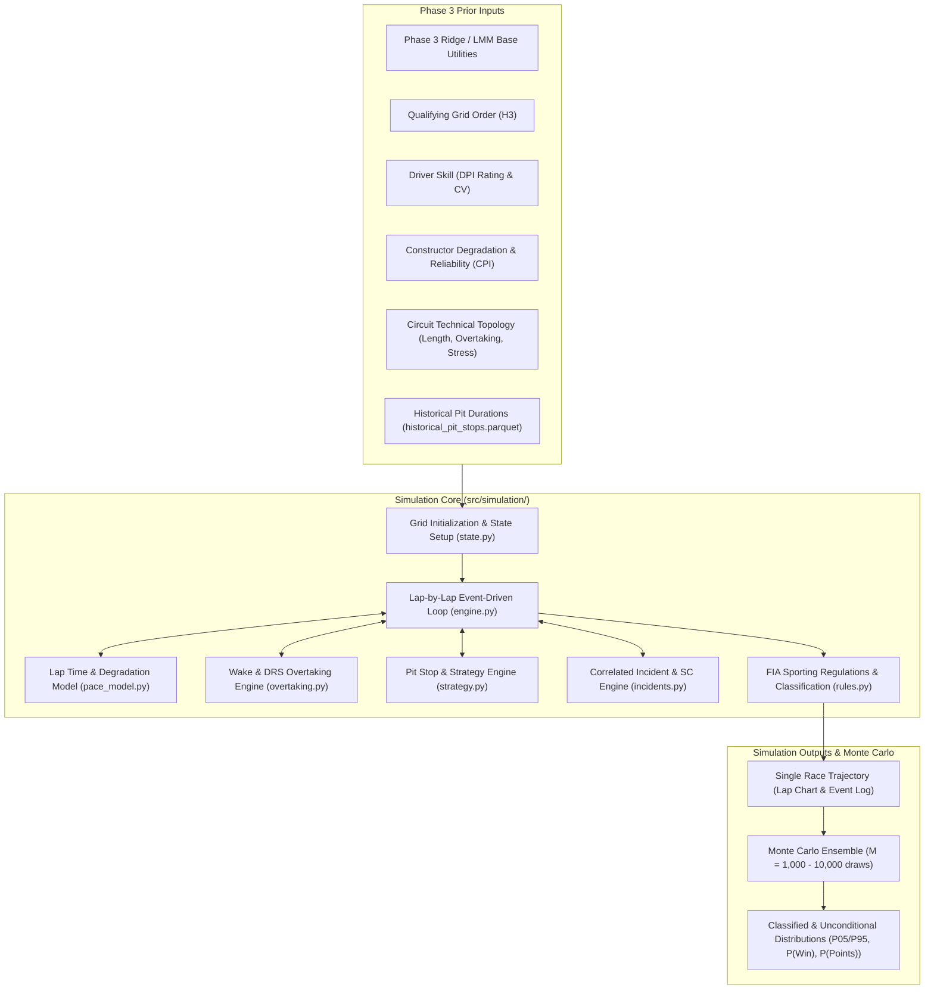
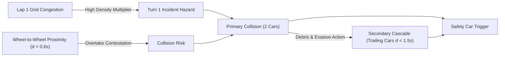
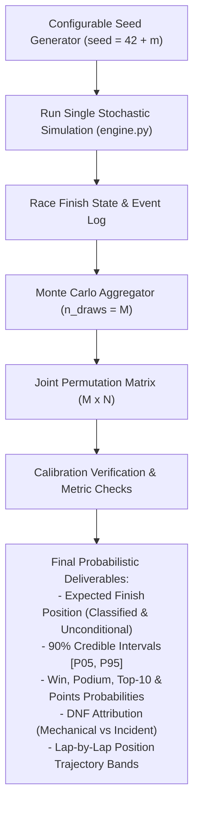

# PACE Phase 4 — Stage 1: Stochastic Race Simulation Engine Architecture & Mathematical Methodology

**Project:** PACE (Predictive Analytics for Competitive Evaluation)  
**Phase:** Phase 4 — Stochastic Race Simulation Engine  
**Stage:** Stage 1 — Simulation Architecture, State Representation, Event System, and Mathematical Methodology  
**Status:** Design Proposal Complete — Submitted for User Review & Formal Approval  

---

## 1. Executive Summary & Purpose

In Phase 3, PACE established a validated, mathematically consistent performance modelling framework. Using expanding-window walk-forward backtesting, Phase 3 demonstrated that strongly regularized linear/hierarchical models (**Ridge Position Regressor**, MAE 3.54; **Bayesian Linear Mixed-Effects Model**, MAE 3.62) achieve superior predictive calibration over tree rankers at Horizon H3 (post-qualifying). Phase 3 also resolved all mathematical discrepancies via an exact Plackett-Luce Gumbel-max choice engine and calibrated DNF outcome partition.

However, Phase 3 models predict finishing positions at an aggregate weekend level. Real Formula 1 races are dynamic, interactive physical systems where:
1. Cars interact through aerodynamic wake (dirty air), tyre degradation cliffs, and DRS zones.
2. Pit stop timing creates strategic undercuts and overcuts.
3. Accidents are correlated (e.g. Lap 1 Turn 1 collisions, close-proximity battles).
4. Safety Cars (SC) and Virtual Safety Cars (VSC) collapse gaps, neutralise advantages, and trigger mass pit stop cascades.
5. Weather shifts disrupt tyre compound operating windows.

**Phase 4 Objective:** Build a stochastic, event-driven, lap-by-lap race simulation engine that models the entire 22-car grid collectively. The engine anchors directly on Phase 3 performance indices (DPI, CPI, Grid Position) as prior speed estimates, while simulating the emergent physical and strategic phenomena of Grand Prix racing.

Per the Phase 4 Implementation Principles, this document establishes **Stage 1**: the simulation architecture, state representation, event dispatcher, physical equations, and validation protocol.

---

## 2. System Architecture & Modular Design

The simulation engine is structured into modular, decoupled subsystems located under `src/simulation/`:

### Module Responsibilities

| Module | File Path | Primary Responsibility |
| :--- | :--- | :--- |
| **State Representation** | `src/simulation/state.py` | Holds mutable `CarState` (track position, accumulated time, tyre age, compound, damage) and `RaceState` (current lap, flag status, weather, SC state). |
| **Event System** | `src/simulation/events.py` | Event dataclasses (`PitStopEvent`, `OvertakeEvent`, `IncidentEvent`, `SafetyCarEvent`) and priority event dispatcher. |
| **Pace Engine** | `src/simulation/pace_model.py` | Computes lap times combining Phase 3 baseline pace, tyre compound degradation, latent fuel burn-off, and driver execution variance. |
| **Traffic & Overtaking** | `src/simulation/overtaking.py` | Simulates dirty air penalties ($d < 1.5\text{ s}$), DRS boost ($d < 1.0\text{ s}$), and track-specific overtake probabilities. |
| **Strategy Engine** | `src/simulation/strategy.py` | Manages stint planning, compound selection (2-compound FIA rule), pit window execution, and opportunistic pit stops under SC/VSC. |
| **Incidents & Safety Car**| `src/simulation/incidents.py` | Models correlated crash contagion, wheel-to-wheel collision hazard, constructor mechanical failures, and SC bunching kinematics. |
| **Sporting Rules** | `src/simulation/rules.py` | Enforces 90% distance classification rule, post-race penalties, and produces official FIA finishing classifications. |
| **Simulation Orchestrator**| `src/simulation/engine.py` | Coordinates the lap loop for a single race and runs multi-threaded Monte Carlo ensembles across configurable seeds. |

---

## 3. Grid-Level State Representation

A fundamental requirement of Phase 4 is that the simulator must model the grid **collectively** rather than simulating isolated drivers.

### 3.1 `CarState` (Driver / Vehicle State)
For each driver $i \in \{1, \dots, N\}$ at lap $L$:
- `driver_id`: Canonical driver identifier (e.g. `russell`, `antonelli`).
- `constructor_id`: Canonical constructor identifier (e.g. `mercedes`, `mclaren`).
- `grid_position`: Starting grid position $G_i \in \{1, \dots, N\}$.
- `track_position`: Current running position on track $R_{i,L} \in \{1, \dots, N\}$.
- `elapsed_time`: Cumulative race time elapsed $T_{i,L} = \sum_{\ell=1}^L t_{i,\ell}$ (seconds).
- `gap_to_leader`: $T_{i,L} - T_{\text{leader},L}$ (seconds).
- `gap_to_car_ahead`: Time gap to car in position $R_{i,L} - 1$ (seconds).
- `laps_completed`: Total completed race laps $L_i$.
- `current_compound`: Active tyre compound $C_i \in \{\text{Soft}, \text{Medium}, \text{Hard}, \text{Intermediate}, \text{Wet}\}$.
- `tyre_age`: Laps completed on current tyre set $a_i \in \{1, 2, \dots\}$.
- `compounds_used`: Set of distinct compounds run so far $\{C_{i,1}, C_{i,2}, \dots\}$.
- `pit_stops_count`: Total pit stops executed $K_i$.
- `in_pit_lane`: Boolean indicating vehicle is servicing in pit lane on lap $L$.
- `damage_factor`: Aerodynamic or suspension performance degradation factor $\delta_{\text{damage}} \ge 0.0$ (s/lap).
- `penalties_accrued`: Post-race or pit-served time penalties $P_i$ (seconds).
- `status`: Classification state $S_i \in \{\text{Active}, \text{Finished}, \text{DNF\_Mechanical}, \text{DNF\_Incident}, \text{DNS}, \text{DSQ}\}$.
- `retirement_lap`: Lap number of retirement (if applicable).

### 3.2 `RaceState` (Global Environmental & Regulatory State)
At lap $L$:
- `current_lap`: Active lap index $L \in \{1, \dots, L_{\text{total}}\}$.
- `total_laps`: Scheduled race distance $L_{\text{total}}$ (e.g. 58 laps at Albert Park).
- `circuit_id`: Canonical circuit identifier.
- `circuit_length_km`: Lap distance in kilometers.
- `track_condition`: Surface condition $\Omega \in \{\text{Dry}, \text{Damp}, \text{Wet}\}$.
- `track_temperature_c`: Surface temperature (affects tyre thermal wear).
- `race_mode`: Course condition $\mathcal{M} \in \{\text{Green}, \text{Yellow\_Local}, \text{VSC}, \text{SafetyCar}, \text{RedFlag}\}$.
- `sc_laps_remaining`: Duration remaining for active SC deployment.
- `leader_id`: Driver currently holding P1.
- `active_field`: List of active `CarState` instances sorted ascending by track position.
- `incident_log`: Chronological journal of all race events.

---

## 4. Base Pace & Lap Time Decomposition

### 4.1 Input Classification: Observed vs. Inferred Quantities

To prevent ungrounded assumptions, inputs are strictly categorised:

| Variable | Classification | Source / Determination |
| :--- | :--- | :--- |
| **Grid Position ($G_i$)** | **Observed** | Saturday qualifying results (`historical_qualifying.parquet`). |
| **Circuit Characteristics** | **Observed** | Length, altitude, corners, base pit loss (`circuit_characteristics.parquet`). |
| **Historical Pit Stop Loss** | **Observed** | Empirical pit transit time (`historical_pit_stops.parquet`). |
| **Driver Consistency CV** | **Observed** | Lap time variance from clean stints in `historical_laps.parquet`. |
| **Base Lap Speed Delta** | **Inferred (Phase 3)** | Derived from Phase 3 Ridge / Bayesian LMM utilities and CPI pole gap. |
| **Tyre Wear Rates ($\beta_{\text{deg}}$)** | **Inferred (Phase 3)** | Robust Huber regression slopes from historical stint laps. |
| **Latent Fuel Mass ($m_{\text{fuel}}$)** | **Inferred** | Regulated capacity ($110\text{ kg}$) depleting linearly per lap. |
| **Dirty Air Wake Deficit** | **Inferred (Physics)**| Aerodynamic penalty ($\Delta t_{\text{wake}}$) based on following gap ($d < 1.5\text{ s}$). |

### 4.2 Lap Time Equation

For an active car $i$ completing lap $L$ under Green flag conditions:

$$t_{i,L} = t_{\text{base}} + \Delta t_{\text{driver/car}} + \Delta t_{\text{fuel}}(L) + \Delta t_{\text{tyre}}(C_i, a_i) + \Delta t_{\text{wake}}(d_{i,i-1}) - \Delta t_{\text{DRS}} + \delta_{\text{damage}} + \epsilon_{i,L}$$

Where:
1. **$t_{\text{base}}$:** Circuit reference lap time (seconds) under clean track conditions.
2. **$\Delta t_{\text{driver/car}}$:** Inherent performance offset anchored directly on Phase 3:
   $$\Delta t_{\text{driver/car}} = -0.05 \times (\text{Ridge\_Utility}_i - \overline{\text{Utility}})$$
   Ensures the simulator starts from the exact, verified Phase 3 speed hierarchy.
3. **$\Delta t_{\text{fuel}}(L)$ (Latent Fuel Depletion):**
   F1 cars carry up to $110\text{ kg}$ of fuel at race start, depleting linearly to $\approx 2\text{ kg}$ at lap $L_{\text{total}}$. Vehicle mass reduces by $\approx \frac{108}{L_{\text{total}}}\text{ kg/lap}$.
   $$\Delta t_{\text{fuel}}(L) = \gamma_{\text{fuel}} \times \left(1.0 - \frac{L}{L_{\text{total}}}\right) \times \text{fuel\_sensitivity}_{\text{circuit}}$$
   Where circuit fuel sensitivity ($\approx 0.035\text{ to }0.055\text{ s/lap/10kg}$) scales with track length and acceleration zones. As fuel burns off, base pace accelerates naturally.
4. **$\Delta t_{\text{tyre}}(C_i, a_i)$ (Tyre Compound & Degradation):**
   - **Compound Baseline Speed:** Soft is fastest ($\Delta t_{\text{compound}} = -0.5\text{ s}$), Medium is baseline ($0.0\text{ s}$), Hard is slower ($+0.6\text{ s}$).
   - **Linear Wear:** $\beta_{\text{deg}}(C_i) \times a_i$ (Huber estimated slope).
   - **Non-Linear Thermal Cliff:** When tyre age exceeds compound limit ($a_i > A_{\text{cliff}}$):
     $$\Delta t_{\text{cliff}} = \lambda_{\text{cliff}} \times (a_i - A_{\text{cliff}})^2$$
5. **$\epsilon_{i,L}$ (Stochastic Driver Execution Noise):**
   $$\epsilon_{i,L} \sim \mathcal{N}(0, \sigma_{i,\text{pace}}^2)$$
   Where $\sigma_{i,\text{pace}} = \text{driver\_consistency\_cv}_i \times t_{\text{base}}$. Consistent drivers (e.g. Verstappen, Hamilton: $\sigma \approx 0.15\text{ s}$) maintain tighter lap time distributions than rookies ($\sigma \approx 0.35\text{ s}$).

---

## 5. Traffic, Wake & Overtaking Dynamics

### 5.1 Dirty Air Aerodynamic Penalty
When car $i$ follows car $j = i-1$ within following gap $d_{i,j} = T_{i,L-1} - T_{j,L-1} \le 1.5\text{ seconds}$:
- Loss of downforce in corners induces understeer and increases tyre thermal surface degradation.
- Wake penalty:
  $$\Delta t_{\text{wake}}(d) = \begin{cases} \Delta t_{\text{max\_wake}} \times \left(1.0 - \frac{d}{1.5}\right) & \text{if } 0 < d \le 1.5\text{ s} \\ 0 & \text{if } d > 1.5\text{ s} \end{cases}$$
  Where $\Delta t_{\text{max\_wake}} \approx +0.35\text{ s/lap}$.
- Following closely also accelerates tyre wear by $+25\%$ ($\beta_{\text{deg, wake}} = 1.25 \times \beta_{\text{deg}}$).

### 5.2 DRS (Drag Reduction System) Advantage
If car $i$ is within $1.0\text{ second}$ of car $j$ at the end of the lap and racing in Green flag conditions:
- Rear wing flap opens in designated DRS straight zones.
- Time delta benefit: $\Delta t_{\text{DRS}} \approx 0.40\text{ to }0.75\text{ seconds}$ (scaled by circuit straight length).

### 5.3 Overtake Execution Probability
An overtake occurs on lap $L$ if:
1. Car $i$ is within DRS range ($d_{i,j} \le 1.0\text{ s}$).
2. Car $i$'s net pace potential exceeds car $j$'s pace by more than the circuit overtake delta threshold:
   $$\Delta \text{Pace} = t_{j,L}^{\text{clean}} - t_{i,L}^{\text{clean}} + \Delta t_{\text{DRS}} - \Delta t_{\text{wake}}$$
3. The overtake probability is modelled via a calibrated logistic function:
   $$P(\text{Overtake}_{i \to j}) = \frac{1}{1 + \exp\left(-\kappa_{\text{overtake}} \times (\Delta \text{Pace} - \Delta_{\text{circuit\_threshold}})\right)}$$
   Where $\Delta_{\text{circuit\_threshold}}$ depends on the circuit's `overtaking_difficulty_rating`:
   - Low difficulty (e.g. Bahrain, Monza): $\Delta_{\text{threshold}} \approx 0.40\text{ s}$.
   - Medium difficulty (e.g. Silverstone, Austin): $\Delta_{\text{threshold}} \approx 0.75\text{ s}$.
   - High difficulty / Street (e.g. Monaco, Singapore, Hungaroring): $\Delta_{\text{threshold}} \approx 1.40\text{ s}$.

### 5.4 DRS Train Emergent Dynamics
If Car A is slower than Car B, but Car B is stuck within $1.0\text{ s}$ of Car A without sufficient delta to pass, Car B receives DRS, preventing Car C behind from overtaking Car B. The simulation naturally exhibits realistic **DRS Trains**, holding up faster cars until pit stops break the congestion.

---

## 6. Strategy & Pit Stop Dynamics

### 6.1 Pit Lane Transit Loss
Executing a pit stop incurs a time penalty $T_{\text{pit}}$ added directly to the car's cumulative race time:
$$T_{\text{pit}} = T_{\text{pit\_lane\_transit}} + T_{\text{stationary\_service}} + \epsilon_{\text{pit\_error}}$$
- $T_{\text{pit\_lane\_transit}}$: Calibrated per circuit from `historical_pit_stops.parquet` ($\approx 18.0\text{ to }24.0\text{ s}$ under Green flag).
- $T_{\text{stationary\_service}}$: Tyre change service ($\approx 2.4\text{ s}$ normal).
- $\epsilon_{\text{pit\_error}}$: Heavy-tailed log-normal distribution for slow stops (sticky wheel nut, traffic release delay: 95% stops $2.1-3.2\text{ s}$, 5% stops $4.0-10.0\text{ s}$).

### 6.2 Regulatory Compliance
- Every car must use at least **two distinct dry compounds** (e.g. Medium + Hard, or Soft + Hard) in a dry race (FIA Sporting Regulations Article 30.5).
- A car failing to execute at least one mandatory pit stop is flagged for disqualification (`DSQ`) by the rules engine.

### 6.3 Pit Stop Decision Logic
A car triggers a pit stop under three conditions:
1. **Scheduled Stint Expiry:** Tyre age exceeds optimal stint length $a_i \ge A_{\text{target}}$ and degradation cost exceeds fresh tyre out-lap delta.
2. **Thermal Cliff Breach:** Lap time delta from tyre degradation exceeds $\Delta t_{\text{cliff\_threshold}} \ge 2.2\text{ s}$.
3. **Opportunistic Safety Car Pit Stop:** Under SC or VSC, the speed limit on track is reduced, whereas the pit lane speed limit remains $80\text{ km/h}$. Consequently, the net pit stop time loss drops from $\approx 22\text{ s}$ to $\approx 11-13\text{ s}$ ("cheap pit stop"). Active cars within the pit entry window evaluate whether switching to fresh tyres yields a net race time advantage.

### 6.4 Undercut vs. Overcut Mechanics
- **Undercut:** Car trailing by $1.5\text{ s}$ pits 1 lap earlier, gains $1.8\text{ s}$ on fresh tyres, and emerges ahead when the rival pits on the subsequent lap.
- **Overcut:** On low-degradation circuits with difficult warm-up (cold hard tyres), staying out on warm tyres while the rival struggles on an out-lap allows the leading car to extend its lead.

---

## 7. Correlated Attrition & Incident Engine

A critical limitation of independent probability models is that F1 retirements are not independent coin flips. PACE Phase 4 implements **correlated, conditional incident modelling**.

### 7.1 Correlated Collision Dynamics

1. **Lap 1 / Turn 1 Spatial Density Hazard:**
   On Lap 1, all 22 cars are packed within a 2-second envelope. Incident risk is scaled by a density multiplier:
   $$\lambda_{\text{incident}}(L=1) = \lambda_{\text{base}} \times 8.0 \times \text{overtaking\_difficulty}$$
2. **Wheel-to-Wheel Contestation Hazard:**
   During an active overtake attempt when cars are side-by-side ($d < 0.6\text{ s}$):
   $$\lambda_{\text{collision}} = \lambda_{\text{battle}} \times (1.0 - \text{driver\_consistency\_cv}_i) \times (1.0 - \text{driver\_consistency\_cv}_j)$$
3. **Secondary Contagion (Chain Reaction):**
   When a primary collision occurs between Car A and Car B, trailing cars within a following window $d \le 1.2\text{ s}$ roll a conditional collision/damage check ($P(\text{Contagion}) \approx 0.25$). This naturally reproduces multi-car pile-ups and opening-lap chain reactions.

### 7.2 Mechanical Failure Hazard
Mechanical retirements are evaluated per lap via a Poisson hazard:
$$\lambda_{\text{mech}}(i, L) = \frac{-\ln(\text{cpi\_reliability}_i)}{L_{\text{total}}} \times \left(1.0 + 0.3 \times \frac{\text{altitude}_m}{1000.0}\right) \times \left(1.0 + 0.2 \times \text{tyre\_stress}\right)$$
Cars with low reliability (e.g. 0.90) face a steady background attrition rate, amplified on high-altitude (Mexico, Austria) and high-vibration circuits.

### 7.3 Safety Car & VSC Deployment Mechanics
When an incident or mechanical stoppage occurs:
1. **Severity Check:**
   - Minor stoppage off-line: **Virtual Safety Car (VSC)** deployed. All cars reduce pace by $35\%$ ($t_{\text{lap}} = 1.35 \times t_{\text{base}}$). Gaps between cars are preserved.
   - Significant crash, track debris, or crane required: **Full Safety Car (SC)** deployed.
2. **Full Safety Car Bunching Kinematics:**
   - Safety car picks up the race leader. Lap times are capped at $t_{\text{SC}} \approx 1.45 \times t_{\text{base}}$.
   - Time gaps between consecutive cars are collapsed to standard restart spacing ($\approx 0.5\text{ to }0.8\text{ s}$).
   - Entire field bunches together, wiping out prior leads!
3. **Restart Dynamics:**
   - Lapped cars between leaders are waved past to unlap themselves before restart.
   - On the restart lap (Green flag restored), tyre temperatures are lower, creating an elevated overtake and incident hazard window for 2 laps.

---

## 8. Weather & Dynamic Track Transitions

Track conditions $\Omega$ evolve stochastically across race laps:
- **States:** $\text{Dry} \to \text{Damp} \to \text{Wet} \to \text{Damp} \to \text{Dry}$.
- **Grip & Pace Multipliers:**
  - Dry slick tyres in Damp conditions: $+3.5\text{ s/lap}$, high spin risk.
  - Intermediate tyres in Damp conditions: optimal crossover window.
  - Dry slick tyres in Wet conditions: $+15.0\text{ s/lap}$, massive incident hazard.
- **Strategic Dilemma:** Simulates teams gambling on staying out on slicks during brief showers vs. pitting for intermediates.

---

## 9. Classification & FIA Sporting Rules Engine

In strict adherence to official Formula 1 regulations:

1. **Classified Finish (Article 54.1):**
   A car is classified in the final results if and only if it completes **at least 90%** of the winner's total laps:
   $$L_i \ge \lfloor 0.90 \times L_{\text{winner}} \rfloor$$
   Lapped cars completing $\ge 90\%$ distance are classified finishers in order of laps completed and elapsed time.
2. **Retirements (DNF):**
   Cars completing $< 90\%$ distance are unclassified retirements. Among unclassified cars, they are ranked behind all classified cars, ordered by the number of laps completed prior to retirement.
3. **Disqualifications (DSQ) & Did Not Start (DNS):**
   - DNS cars did not start lap 1 and are ranked at the rear.
   - DSQ cars (e.g. technical infringement, failure to use 2 compounds) are classified at the very rear with status `DSQ`.
4. **Time Penalties:**
   Post-race penalties (+5s, +10s) are added to cumulative race time $T_{i,L_{\text{total}}}$ before the final classification order is computed.

---

## 10. Monte Carlo Simulation & Output Calibration Framework

To produce calibrated probabilistic forecasts, the simulator executes $M = 1,000\text{ to }10,000$ independent stochastic runs per race event across configurable seeds.

### Mathematical Calibration Guarantees
1. **Permutation Guarantee:** Every draw $m \in \{1, \dots, M\}$ yields a strictly valid permutation of $\{1, \dots, N\}$.
2. **Doubly Stochastic Matrix:** Across all draws:
   - For every driver $i$: $\sum_{k=1}^N P(\text{Finish}_i = k) = 1.0$.
   - For every finishing position $k$: $\sum_{i=1}^N P(\text{Finish}_i = k) = 1.0$.
3. **Expected Finishing Position:**
   $$\mathbb{E}[\text{Pos}_i] = \frac{1}{M} \sum_{m=1}^M \text{pos}_i^{(m)}$$
4. **90% Credible Intervals:** $[P05, P95]$ derived directly from empirical percentiles of the joint simulated position distribution.

---

## 11. Incremental Implementation Roadmap

Per the user's instructions, Phase 4 will be built and verified in six incremental stages:

| Stage | Focus Area | Deliverables & Verification Gates |
| :---: | :--- | :--- |
| **Stage 1** | **Architecture & Methodology** | **Current Stage:** Architecture proposal, mathematical equations, state representations, and test suite design. (Requires User Approval). |
| **Stage 2** | **Baseline Simulation Engine** | Core state representation (`state.py`), lap event loop (`engine.py`), Phase 3 baseline pace anchoring, deterministic finishing order. Verified on 2026 Round 5. |
| **Stage 3** | **Tyres, Fuel & Strategy** | Stint degradation curves (`pace_model.py`), fuel burn-off, pit stops (`strategy.py`), 2-compound FIA rule, undercut/overcut mechanics. |
| **Stage 4** | **Traffic, Wake & Overtaking** | Dirty air wake penalty, DRS activation, probabilistic overtaking function, DRS train dynamics (`overtaking.py`). |
| **Stage 5** | **Incidents, Attrition & SC/VSC** | Correlated crash contagion, mechanical failures, SC bunching, VSC delta, weather changes (`incidents.py`, `rules.py`). |
| **Stage 6** | **Monte Carlo & Calibration** | Multi-threaded Monte Carlo orchestrator, calibration tests, historical backtesting comparison against 2023–2026 Grand Prix events. |

---

## 12. Verification Plan for Stage 1

To ensure Stage 1 is robust and mathematically sound before implementing Stage 2:
1. **Mathematical Consistency:**
   - Confirm that the base lap time equation rigorously reduces to the Phase 3 Ridge / LMM predictions when degradation, wake, and fuel deltas are set to zero.
   - Verify that the state transition function $T_{i,L} = T_{i,L-1} + t_{i,L}$ preserves strict temporal monotonicity.
2. **FIA Regulatory Compliance:**
   - Verify that the 90% lap completion threshold and 2-compound rules are explicitly defined in the state transitions.
3. **Reproducibility:**
   - Confirm that every stochastic component (pace noise, pit stop error, overtake roll, incident hazard) is derived from explicit, configurable PRNG streams (`np.random.RandomState(seed)`).

---

## 13. Decision Request

Stage 1 (Methodology, State Representation, and Architectural Design) is complete. We request user approval of this design before proceeding to **Stage 2: Implementation of the Baseline Race Simulation**.
